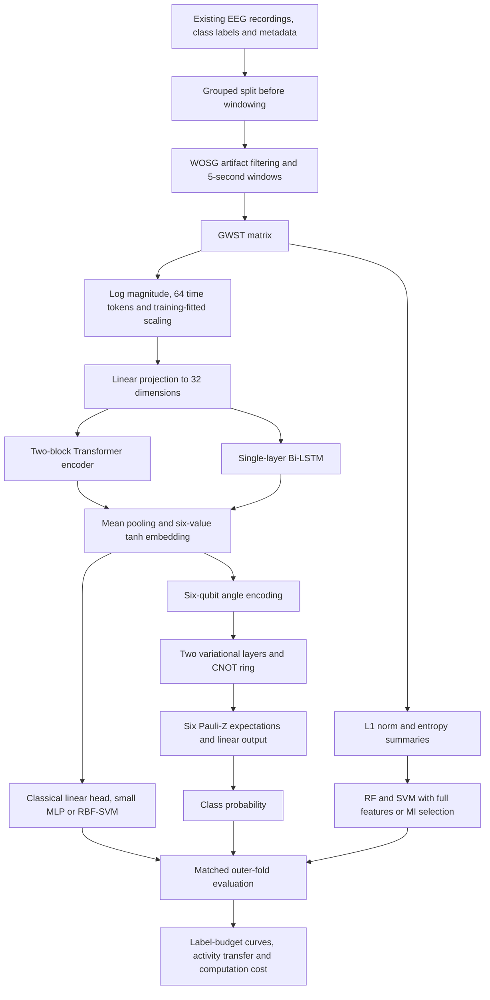

# 1. What they did

- **Main base paper selected for this project** - Shaswati Dash, Dinesh Kumar Dash, Rajesh Kumar Tripathy & Ram Bilas Pachori, *Time-frequency domain machine learning for detection of epilepsy using wearable EEG sensor signals recorded during physical activities*, Biomedical Signal Processing and Control, volume 100, article 107041, February 2025. They classified healthy and epilepsy cases from wearable EEG during physical activities using GWST features and ML/DL classifiers. They also tested held-out activities and performed subject-independent evaluation on CHB-MIT. [Main paper PDF](Main_Base_Paper_Wearable_EEG_Epilepsy_Time_Frequency_ML_2025.pdf)
- **Bhalerao & Pachori (2025) — supporting base paper:** Used multivariate swarm sparse decomposition and joint time-frequency analysis with deep features for imagined-speech EEG recognition. This provides a supporting feature-extraction reference for our project.

Our starting baseline follows the main paper's wavelet-domain optimized Savitzky-Golay artifact filtering, 5-second windows, GWST representation, 450 L1-norm/Shannon-entropy features and random forest classifier. Its held-out-activity evaluation provides the starting protocol for our experiments.

# 2. What we are targeting

We aim to extend the base paper with a hybrid classical-quantum model for healthy-versus-epilepsy classification from wearable EEG, comparing a compact Transformer encoder with a Bi-LSTM for feature learning.

- **Architecture:** EEG -> artifact filtering -> 5-second windows -> GWST time-frequency representation -> Transformer encoder or Bi-LSTM -> pooling -> six-value embedding -> quantum classifier -> class probability. Preserve time-bin sequences for the encoder input.
- **Proposed quantum model:** A six-qubit variational quantum classifier (VQC), initially with two trainable rotation/entanglement layers, angle encoding and a classical sigmoid output head. This is the proposed starting configuration for simulator experiments.
- **Initial experiments:** Reproduce GWST + random forest, then train the Transformer and Bi-LSTM with classical heads. Compare the better validated encoder with classical and quantum heads using matched embeddings and splits.
- **Research target:** Test whether the compact quantum head improves performance with limited training labels and across held-out activities. The base paper already evaluates deep models and activity transfer, so the architecture's novelty requires a closer literature check.
- **Evaluation:** Keep recordings together, split by participant where IDs permit, and fit preprocessing/tuning on training data. Report balanced accuracy, sensitivity, specificity, macro-F1 and runtime across reduced training-label budgets.

# 3. Architecture

## 3.1 Basis in the reviewed PDFs

The folder contains nine PDFs representing eight unique papers. The two wearable-GWST PDFs have identical contents. The table records how each unique paper informs the design. The imagined-speech paper mentioned in section 1 is referenced from earlier discussion, and its PDF is currently absent from this folder.

| Reviewed paper | Relevant published method | Role in our architecture |
|---|---|---|
| [Dash et al., wearable EEG, 2025](Main_Base_Paper_Wearable_EEG_Epilepsy_Time_Frequency_ML_2025.pdf), Sections 2-3, Tables 1 and 9-11 | WOSG artifact filtering, 5-second windows, GWST L1-norm/entropy features, ML/DL comparisons, mutual-information selection and activity holdouts. | Main preprocessing and feature baseline. Its Transformer, LSTM and Bi-LSTM comparisons must be acknowledged. |
| [Pachori & Patidar, 2014](EEG_Seizure_Classification_Second_Order_Difference_IMFs_2014.pdf), Section 2 | EMD, second-order difference plots of IMFs, ellipse-area features and an ANN classifier. | Optional nonlinear-feature baseline using our dataset and splits. |
| [Sharma & Pachori, phase-space analysis, 2015](EEG_Seizure_Classification_Phase_Space_IMFs_2015.pdf), Section 2 | EMD, 2D/3D phase-space features and LS-SVM classification. | Optional comparison for compact nonlinear representations. |
| [Sharma et al., IMF entropy, 2015](Focal_EEG_Identification_IMF_Entropy_Measures_2015.pdf), Sections 2 and 5 | Entropy features from IMFs and LS-SVM for focal/non-focal EEG. | Supports entropy-feature comparisons. Its focal/non-focal labels require a separate task definition if that dataset is used. |
| [Bhattacharyya et al., TQWT, 2017](Epileptic_EEG_Classification_Tunable_Q_Wavelet_Multiscale_Entropy_2017.pdf), Figure 1 and Section 5 | Tunable-Q wavelet decomposition, multiscale K-NN entropy, wrapper selection and RBF-SVM. | Optional TQWT/entropy baseline with selection confined to training folds. |
| [Bhattacharyya & Pachori, multivariate EWT, 2017](Patient_Specific_EEG_Seizure_Detection_Multivariate_EWT_2017.pdf), Sections III-VI | Five-channel selection, joint oscillations, amplitude-derived features and feature processing for patient-specific CHB-MIT seizure detection. | Supports a separate multichannel comparison if CHB-MIT is used. The primary wearable input has one channel. |
| [Jain & Tripathi, airwriting preprint, 2026](EEG_Airwriting_Supervised_Contrastive_Learning_2026_Preprint.pdf), Sections 2.3-2.4 | EEGNet/DeepConvNet encoders with two-stage supervised contrastive learning and a frozen-encoder classifier. | Background for encoder/head experiments. Its contrastive objective is outside the initial training configuration chosen here. |
| [Tripathi et al., sleep corpus, 2025](Boston_Childrens_Hospital_Sleep_Corpus_2025.pdf), Methods and Data Records | PSG data organized with patient/session identifiers, sleep stages and event annotations. | Informs metadata organization. Using this corpus would require a sleep-specific prediction target. |

The Transformer dimensions, time-token construction and VQC below are our proposed engineering choices. These reviewed PDFs supply the classical EEG methods and comparisons. Their task-specific accuracy values will be kept with their original datasets and protocols.

## 3.2 Prediction target and data contract

The initial target is binary classification of wearable EEG windows labelled by healthy/epilepsy recording status. Define healthy as 0 and epilepsy as 1. Report recording-level predictions by averaging probabilities over all valid windows from a recording, with a decision threshold chosen on validation data.

Create a manifest containing recording path, class, activity, participant ID when documented, session ID, sampling rate, duration and quality flags. Check missing values, duplicate files, truncated recordings, class balance and participant/activity coverage. The main paper describes FP1 EEG at 512 Hz and 20-second recordings. Counts of recordings and participants must be audited separately.

Split complete recordings before windowing. If participant IDs exist, group all recordings from each person together. Use activity holdouts for activity transfer and participant holdouts for unseen-person evaluation. A combined person/activity holdout is feasible only with sufficient class coverage. Keep windows and duplicates from the same source together throughout validation and testing.

## 3.3 Reproduce the published baseline

1. Apply the paper's wavelet-domain optimized Savitzky-Golay (WOSG) artifact filtering. Record the wavelet, decomposition depth, window length, polynomial order, boundary handling and optimization criterion from the cited filter implementation. Document any remaining reproduction ambiguity.
2. Divide each recording into non-overlapping 5-second windows. At 512 Hz, each window contains 2,560 samples. A complete 20-second recording yields four windows. Record exclusions and actual counts because the paper's reported frame totals require reconciliation with its selected recordings.
3. Compute the complex GWST matrix, retaining the frequency range specified by the paper, 0.5-50 Hz. The paper reports 225 frequency components. Verify the exact frequency grid and transform convention before reproducing this count, since a standard 5-second FFT grid does not automatically produce that mapping.
4. For each frequency component, calculate the L1 norm over time and the histogram-based Shannon entropy. Section 3.3 describes a normalized histogram with a bin size of 10. Verify its implementation details, including coefficient handling, binning and log convention. Guard empty bins with the usual zero contribution to entropy.
5. Concatenate the two summaries to obtain the reported 450 features. Train RF and SVM baselines. Include mutual-information feature selection because the main paper already examines it.
6. Table 1 gives RF with 10 trees, minimum split size 2 and minimum leaf size 1 as a reproduction starting point. Its LSTM has 10, 30 and 50 recurrent units, followed by a 70-unit dense layer. Resolve sequence layout and other settings from the paper before claiming an exact neural-model reproduction.

All learned preprocessing settings, scaling and selection use the training partition. Recompute them inside each validation fold.

## 3.4 Proposed temporal GWST input

The neural branch retains time evolution within each 5-second window. Let B be batch size, F the retained frequency-component count and N=2,560 the sample count.

1. Start with GWST coefficients shaped `[B, F, 2560]`.
2. Compute log magnitude as `log(1 + abs(S) / a0)`, with positive reference scale a0 fixed from training data and recorded with its units.
3. Average consecutive groups of 40 time samples within each frequency component. This produces 64 ordered time tokens per window, shaped `[B, 64, F]`. Temporal pooling reduces token count while retaining the transform's original frequency resolution.
4. Standardize each frequency component using source-training statistics. Use the same fitted statistics for validation and test data.
5. Project each token with a learned linear layer `F -> 32`, followed by LayerNorm. The shared encoder input is `[B, 64, 32]`.

If the reproduced frequency grid has F=225, that is the input frequency dimension. Record the actual grid and F rather than silently changing the baseline to force a shape. The 64-token log-magnitude representation is a proposed extension to the paper's window-level summary features.

## 3.5 Two candidate encoders

Train each encoder as an independent candidate. Select settings using inner validation, then report both candidates on the same untouched outer folds.

| Block | Transformer encoder candidate | Bi-LSTM candidate |
|---|---|---|
| Input | `[B, 64, 32]` token sequence | `[B, 64, 32]` token sequence |
| Position information | Add fixed sinusoidal positional encoding | Sequence order handled by recurrence |
| Core | Two pre-norm encoder blocks | One bidirectional LSTM layer |
| Width | Model dimension 32, four heads, eight dimensions per head | Hidden size 16 per direction, giving 32 output values per time step |
| Internal layers | Self-attention, residual connections, feed-forward `32 -> 64 -> 32`, GELU | Standard LSTM gates in each direction |
| Regularization | Dropout 0.1 | Explicit dropout 0.1 on sequence output |
| Pooling | Mean over 64 tokens | Mean over 64 tokens |
| Output | `[B, 32]` | `[B, 32]` |

Use an encoder-only Transformer for this binary classification task. The initial design produces one probability from a complete 5-second window. Its bidirectional/context-based processing makes the prediction available after that window has been acquired.

## 3.6 Shared embedding and quantum classifier

**Embedding.** Apply `LayerNorm(32) -> Linear(32, 6) -> tanh`. Both encoder candidates produce a six-value embedding z. The six coordinates are learned combinations of the time-frequency input. Interpret their relation to EEG frequencies through perturbation or attribution experiments.

**Quantum angles.** Set `angle_i = pi * z_i`. This bounds each input angle within `[-pi, pi]` without fitting scaling on test data.

**VQC circuit.** Use the following initial configuration.

1. Initialize six qubits to the all-zero state.
2. Apply `RY(angle_i)` to qubit i.
3. Repeat two variational layers. Each layer applies trainable `RY(theta[l,i,0])` and `RZ(theta[l,i,1])` to every qubit, followed by an ordered CNOT ring `0->1, 1->2, 2->3, 3->4, 4->5, 5->0`.
4. Measure the Pauli-Z expectation on each qubit, producing six values in `[-1, 1]`.
5. Apply a learned linear map `6 -> 1` to obtain the classification logit. Apply sigmoid for the reported probability.

This circuit has 24 trainable rotation parameters, plus seven parameters in the classical output layer. The first implementation uses analytic expectation values and differentiable statevector simulation. Check that gradients propagate through the circuit to its parameters and, during joint fine-tuning, to the encoder. Evaluate finite-shot sensitivity later with specified shot counts and repeat seeds.

**Matched classical heads.** Evaluate a linear `6 -> 1` head and a nonlinear `6 -> 6 -> 1` tanh MLP on the same frozen embeddings. Also evaluate an RBF-SVM with training-fitted scaling. Include a VQC ablation with the CNOT gates removed to test the contribution of its interactions.

## 3.7 Training protocol

- **Stage A, encoder training.** Train each encoder, its six-value bottleneck and a classical linear head with binary cross-entropy on logits. Proposed defaults are AdamW, learning rate 0.001, weight decay 0.0001, batch size 16, gradient clipping at norm 1, a maximum of 100 epochs and early stopping after 15 epochs without validation-loss improvement. Restore the best validation checkpoint. For imbalance, calculate class weights from training data only.
- **Stage B, head comparison.** Freeze each trained encoder and bottleneck. Train VQC and classical heads on exactly the same embeddings. Initially use learning rate 0.001 for the VQC and output layer, with the same stopping criterion and a comparable tuning budget. Stage A and Stage B both use only the permitted training labels.
- **Stage C, optional joint fine-tuning.** Compare end-to-end VQC fine-tuning against equivalent classical-head fine-tuning. Start with encoder learning rate 0.0001 and head learning rate 0.001. Treat frozen and jointly trained experiments as distinct results.
- **Label budgets.** Repeat the entire encoder/head training process at 25%, 50%, 75% and 100% of labelled source-training groups where sample counts permit. Sample whole participants when identifiable, otherwise whole recordings. Include validation labels in the budget and preserve both classes. Reuse the same subsets and seeds across models.
- **Reproducibility.** Begin with seeds 0, 1 and 2, increasing repetitions if uncertainty warrants it. Save fold manifests, configuration, frequency grid, normalization statistics, best checkpoints and label-budget counts.

The defaults above are starting settings to validate. They have not been trained or benchmarked on the dataset.

## 3.8 Comparisons and reporting

| Experiment | Input and classifier | Question answered |
|---|---|---|
| Published feature baseline | 450 GWST summaries + RF/SVM | Can we reproduce the starting classical performance under our audited splits? |
| Feature reduction baseline | GWST summaries + MI selection + RF/SVM | How competitive is ordinary feature reduction? |
| Transformer classical | Temporal GWST + Transformer + six-value embedding + classical heads | Does temporal representation learning help? |
| Bi-LSTM classical | Temporal GWST + Bi-LSTM + the same embedding/head design | Which encoder generalizes better under these splits? |
| Transformer quantum | Transformer embedding + VQC | Does the quantum head improve on matched classical heads? |
| Bi-LSTM quantum | Bi-LSTM embedding + VQC | Does any quantum effect depend on the encoder? |
| Quantum ablation | Matching VQC with CNOT gates removed | What do circuit interactions contribute? |
| Optional signal baselines | EMD/ellipse features, TQWT entropy + classical classifiers | Does a simpler nonlinear representation explain the observed benefit? |

Report balanced accuracy, sensitivity, specificity, macro-F1, AUROC when both classes are present, confusion matrices and worst-activity performance. Report window and recording results with their denominators. Select thresholds on validation data. Compute uncertainty using resampled participants or recordings, with activity-level results shown individually. Report feature-extraction time, training/inference time, encoder/head parameter counts, simulator settings, shot counts and memory use.

For the primary wearable labels, use recording-status classification metrics. A CHB-MIT seizure-event experiment would require separate event definitions, continuous-recording evaluation and false-alarm/delay measures. Keep identities that correspond to the same patient grouped together, including the CHB-MIT cases 01 and 21 identified in the EWT paper.

## 3.9 Architecture diagram

The shared diagram represents the two encoder experiments. Each trained model uses one encoder. The proposed contribution is evaluated through temporal representation, compact embeddings and quantum/classical head comparisons under limited labels and activity shifts. The literature review and experiments must establish its novelty and benefit.
